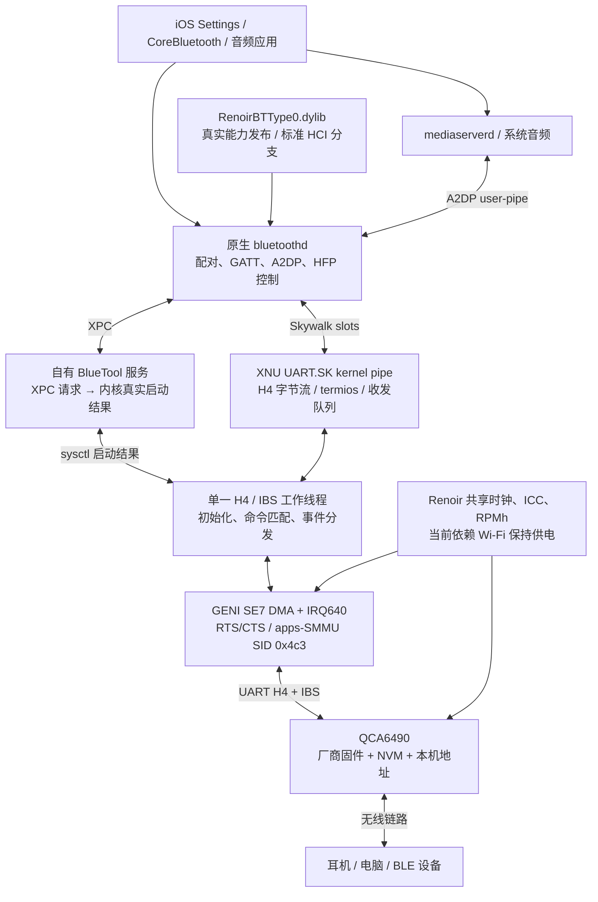

# Renoir XNU Bluetooth

小米 11 Lite 5G **renoir / SM7350 / QCA6490** 的 XNU 蓝牙适配源码、补丁和运行说明。

The Bluetooth patch collection for the Renoir XNU port: Qualcomm GENI UART / H4 / IBS,
Skywalk transport, BlueTool replacement, and a type-0 controller adapter for iOS 20H392.

本仓库从 [ios-renoir](https://github.com/daimile2/ios-renoir) 独立整理，保留已经测试的实现。目标是使用原生 Settings、bluetoothd、配对数据库和 A2DP 协议栈，把它们接到高通控制器上。

| 项目 | 固定目标 |
| --- | --- |
| 设备 | Mi 11 Lite 5G，renoir；不是 Mi 11 Lite 4G |
| 控制器 | QCA6490，HSP 固件分支 |
| 内核 | XNU 8796.141.3，Renoir 移植工程 kernel143 |
| 系统 | iOS 20H392 / arm64；补丁器严格匹配原件哈希和指令 |
| UART | GENI SE7，名义 3200000；100MHz / 2 / 16，计算线速 3125000 |
| 用户态控制器类型 | `THIRD_PARTY_DONGLE = 0`，能力取自真实 HCI 查询 |
| 当前验收 | 原生开关、搜索、配对/重连、耳机 AAC 实际播放 |

## 运行原理图



完整的[启动时序、广播初始化和音频数据通路](docs/ARCHITECTURE.md)包含另外两张时序图。

## 仓库内容

```text
patches/kernel/       12 个按原编号保留的蓝牙内核补丁
patches/series.json   应用顺序、前后文件哈希和来源提交
patches/history/     早期只读前置探测补丁；不重复应用
kernel/files/        kernel143 三个蓝牙实现文件的最终快照
kernel/base/         10 个必要文件的 kernel128 验证基线
userland/            自有 BlueTool 和类型0能力适配库源码
tools/               补丁验证、用户态构建、离线安装、只读固件采集
tests/               生产解析器、工作线程、原件ARM64广播分支测试
config/              硬件、启动资源及共享依赖约定
docs/                原理、集成、测试、进度和许可证说明
```

`kernel/base` 是补丁验证用的最小上下文，**不是完整 XNU，也不能单独编译成可启动内核**。完整运行还需要父工程的板级启动、Wi-Fi供电、共享资源和Skywalk配置。详见[构建与集成](docs/BUILDING.md)；已有kernel143树不应再次应用本系列。

[逐项补丁索引](docs/PATCHES.md) · [本次发布验证](docs/VALIDATION.md) · [GitHub Actions](https://github.com/daimile2/renoir_xnu_bluethooth/actions)

## 快速验证

需要 Python 3.11+、Git、C 编译器；下面三项不需要 Apple 文件、厂商固件或手机：

```sh
python3 tools/check-patches.py
python3 tests/test_bluetooth_h4_parser.py
python3 tests/test_bluetooth_worker_sim.py
```

构建用户态需要自行准备 iOS SDK、Theos 工具链，以及有权使用的**未修改20H392 bluetoothd**：

```sh
bash tools/build-userland.sh /path/to/original-20H392-bluetoothd
```

此命令仅在电脑编译和签名。离线安装、恢复和可选ARM64原件测试见[构建说明](docs/BUILDING.md)。仓库没有自动刷机或重启步骤。

## 当前进度

2026-11-05：原生设置、扫描、配对、密钥重连、高速UART/IRQ和耳机AAC-LC/44.1kHz播放已验证。广播初始启动及重开正确初始化5个实例，本轮旧`712`失败循环为0；外部设备收到广播尚未单独验收。

主要剩余6组：独立供电/物理省电、睡眠和失电重建、BLE隐私及兼容性、耳机麦克风/通话、Wi-Fi并发共存、异常恢复和长期运行。详见[验收与路线](docs/STATUS.md)。

## 许可证与第三方文件

这是**按文件授权的源码集合**：自有用户态/工具/测试/文档采用BSD-3-Clause；Linux原厂流程适配及已有GPL文件采用GPL-2.0-only；XNU kernel-pipe/MAC适配采用APSL-2.0。补丁包含不同组件时按目标文件分别保留授权。`LICENSE`不覆盖第三方文件的既有许可。

请阅读[许可证范围](docs/LICENSING.md)、[来源与致谢](NOTICE.md)及`REUSE.toml`。这里不包含Apple原件/修改后二进制、SDK、厂商固件、NVM、分区镜像、设备地址或个人日志，也不授予这些材料的再分发权。完整组合内核的授权需要按各组件另行核对，本仓库不声明GPL-2.0与APSL-2.0天然兼容。

这是社区实验移植，不隶属于 Apple、Xiaomi 或 Qualcomm，也没有 Bluetooth SIG 认证声明。问题报告与贡献方式见[CONTRIBUTING](CONTRIBUTING.md)。
