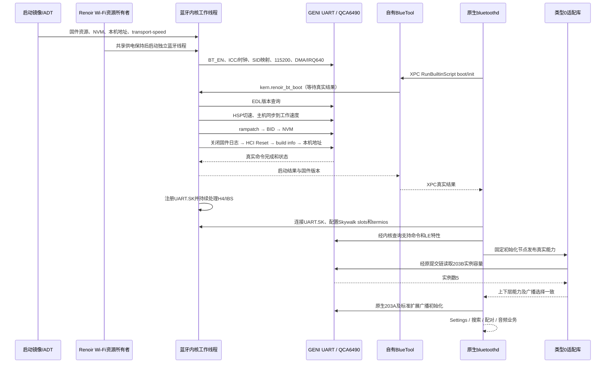
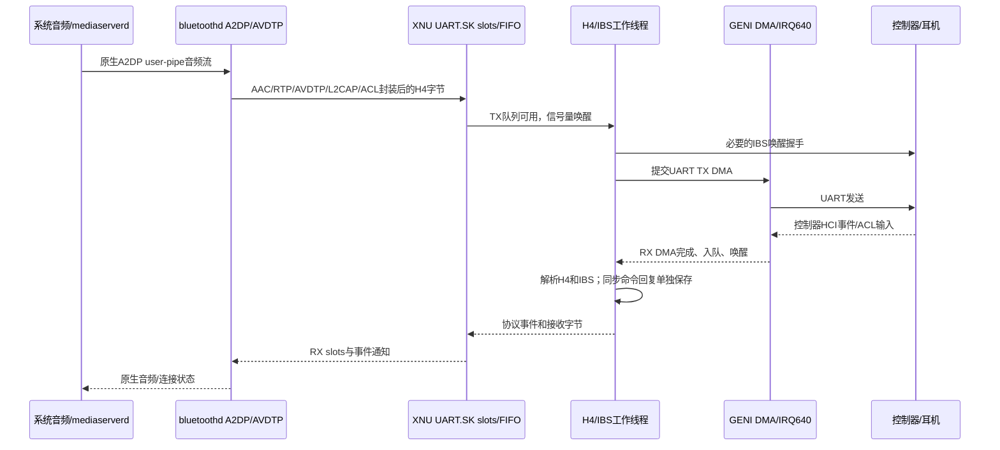

# 蓝牙运行原理

本图描述截至2026-11-05实际实现。虚线说明的省电/恢复缺口见末节。驱动仍借用父工程的共享资源，模块拆分没有改变手机上已验证的执行顺序。

## 1. 启动路径

BlueTool的成功取自内核结果；它不伪造厂商命令完成，也不运行Broadcom脚本。内核下载顺序按固定Linux HSP分支执行，底层UART、GPIO和时钟按本机MiCode分支执行。

`renoir_bluetooth_probe.inc`只承担前置资源探测；运行期所有者在`renoir_bluetooth_hci.inc`。`renoir_bluetooth_transport.inc`提供Skywalk端口和启动结果sysctl。这三个文件被包含进父工程的`renoir_wifi.c`翻译单元；因此仍使用该文件的MMIO、DMA锁等公共接口。

## 2. 收发与实际音频路径

IRQ适配器是父工程的GICv3线程化SPI注册服务。UART层独占DMA状态清理；一个H4工作线程消费字节流，避免初始化和运行期抢读硬件。线程遵循“处理→检查完成条件→未完成才等待”；匹配回包独立于H4解析scratch保存，后续事件不会覆盖它。

A2DP用户管道依赖`com.apple.private.skywalk.register-user-pipe`真实签名权限映射，补丁0140保留逐进程credential检查。蓝牙串口使用kernel pipe，A2DP音频使用user pipe，两者职责不同。

## 3. 类型0与广播修复

原版20H392只为Apple/Broadcom型号建立厂商能力。离线补丁打开类型0注册和分支，类型0厂商命令表保持空；标准功能由支持命令表、LE特性和真实实例容量决定。

适配库通过新增`LC_LOAD_DYLIB`在启动时加载。离线固定跳板调用RW槽里的库函数，运行时不改已签名代码页。对原件哈希、UUID和待替换指令的匹配属于版本约束，不是通用任意版本补丁。

原失败链：探测前缓存单实例旧模式 → 探测后下层已启用扩展广播 → 未执行多实例初始化 → 203B之后仍选择旧2006 → 控制器返回Command Disallowed。修复同时更新model非虚函数字段和广播启动时的模式；随后复用原生203A、2036、2037、2038、2035、2039、203D及其回调。

首次启动和手动关闭后的重开都已验证实例初始化；主机测试另执行了原件启用/清理/重开和失败回调。手机的外部广播接收验证仍单列，不能用“初始化完成”代替。

## 4. 硬件约束与未完成边界

- GENI SE7：UART `0x0099c000`，wrapper `0x009c0000`；GPIO68/69/70/71分别为CTS/RTS/TX/RX，65为BT_EN，91为SW_CTRL。
- 主中断：DT SPI `0x260`，GIC架构INTID **640**，level-high；GPIO71睡眠唤醒不是这条主IRQ。
- apps-SMMU SID `0x4c3`，IOVA起点`0x40000000`；当前映射窗口`0x4000`字节。
- 名义速度3200000，源100MHz、分频2、16倍采样，计算线速3125000；此数值来自实际配置计算，不是逻辑分析仪实测。
- 当前BT供电依赖Wi-Fi维持的共享rail votes。IBS字节协议已运行，物理UART时钟尚未随IBS关闭；GPIO71 runtime wake、真实失电重建、memdump/SSR未完成。
- Settings逻辑关闭会断开UART.SK，不代表BT硬件已完整断电；`deepsleep`返回现有IBS/NVM设置结果，也不代表系统级省电已验收。

依据、提交和许可分别见[NOTICE](../NOTICE.md)、[依赖约定](../config/dependencies.json)及[许可证说明](LICENSING.md)。
